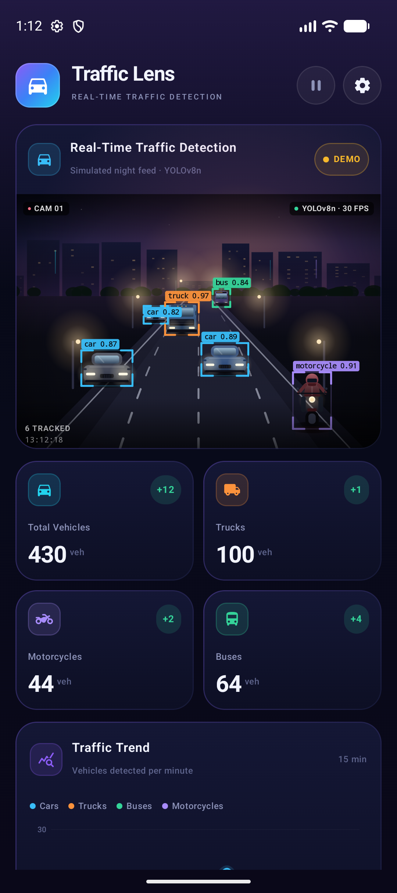
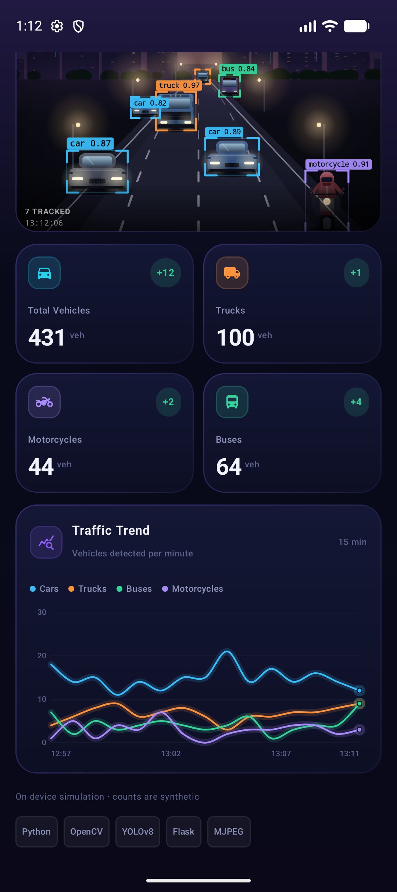
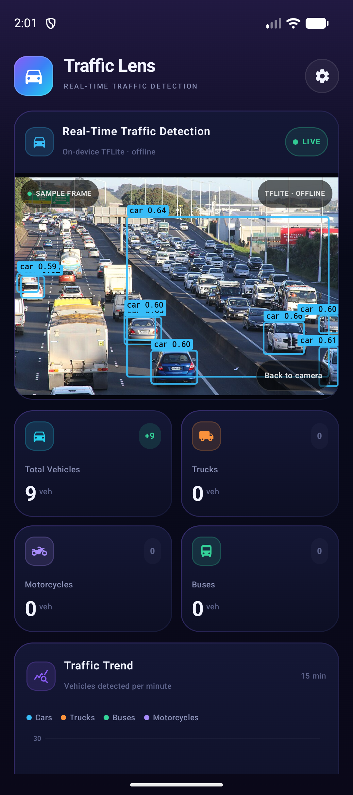
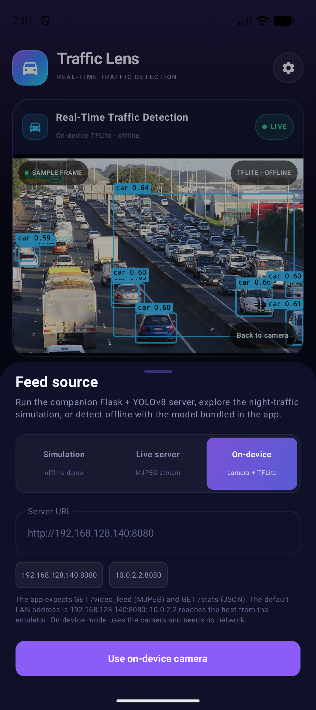
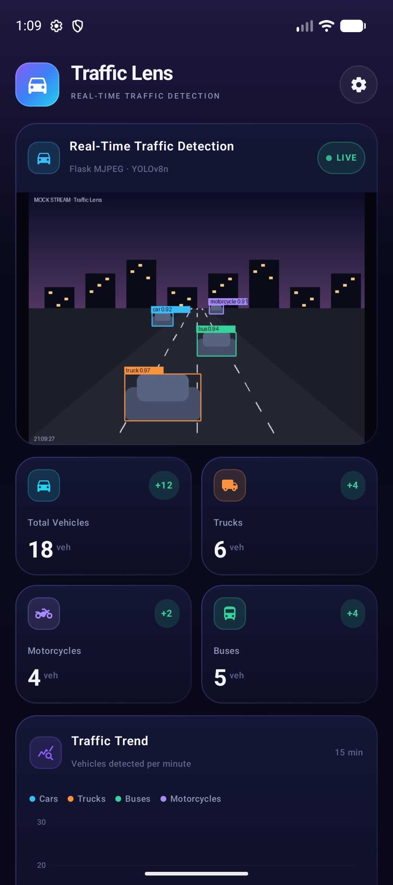

# Traffic Lens — Real-Time Traffic Detection for Android

A native Android dashboard for live traffic object detection, built from the reference design in
`Screenshot_2026-11-17-16-23-52-865_com.facebook.katana.jpg`: a dark neon control room with a live
camera panel, detection boxes, per-class counters and a 15-minute flow chart.

It ships with **three feed sources** — a built-in simulation, a fully **offline on-device detector**
(TensorFlow Lite + CameraX), and the **Python + OpenCV + YOLOv8 + Flask** server from the reference
screenshot over MJPEG.

| Dashboard | Trend & counters | On-device, offline |
| --- | --- | --- |
|  |  |  |

| Feed settings | Live server |
| --- | --- |
|  |  |

## Features

- **Detection panel** — a perspective night-city avenue drawn with Compose `Canvas`, with vehicles
  per class (car / truck / bus / motorcycle), headlights, wet-road reflections and YOLO-style boxes
  with confidence labels and corner brackets.
- **Four KPI cards** — total vehicles, trucks, motorcycles, buses, each with a recent-delta chip.
- **Traffic trend** — four smoothed series over the last 15 minutes, plotted against a 0–30 axis with
  live clock labels, legend and end-point markers.
- **Three feed sources**
  - *Simulation* (default): fully on-device, no network, no camera. Counts, deltas and the trend are
    generated by a small simulator so the dashboard is populated at first launch.
  - *On-device*: camera frames are analysed by a TFLite model bundled in the APK — no network, no
    server, no model download. Works in airplane mode; falls back to a packaged sample frame when
    the camera is missing or permission is denied. Includes a front/back camera switch and
    zoom (pinch or ± buttons, range reported by the camera).
  - *Live server*: consumes `GET /video_feed` (MJPEG) and `GET /stats` (JSON) from `server/app.py`,
    shows the annotated frames and drives every card from the server's telemetry. Connection
    errors, retries and missing telemetry are handled in the UI.
- **Pause / resume** the simulation, plus persisted source and server URL.
- Optional **camera permission** requested only when the on-device source is selected.

## Build

Requirements: JDK 17+ and an Android SDK with platform 35 (`ANDROID_HOME` or `local.properties`).

```bash
./gradlew :app:assembleDebug      # Windows: .\gradlew.bat
./gradlew :app:assembleRelease    # minified (R8) + signed
```

| Variant | Output | Size |
| --- | --- | --- |
| debug | `app/build/outputs/apk/debug/app-debug.apk` | ~42 MB |
| **release (signed)** | `app/build/outputs/apk/release/app-release.apk` | **~16.9 MB** |

Most of the release size is the 4 MB model plus TFLite/CameraX native libraries (arm64-v8a,
armeabi-v7a, x86_64 — `x86` is filtered out).

A ready-to-install signed build is included at [`dist/TrafficLens-1.3.0-release.apk`](dist/TrafficLens-1.3.0-release.apk):

```bash
adb install -r dist/TrafficLens-1.3.0-release.apk
```

SHA-256 of the shipped artifact: `A4518D62D854A68045E2BB1A1E70653EC878014F6F6D63AF003F3C1898C439C0`.

The release variant runs R8 with resource shrinking and is signed with the v2 APK signature scheme
(certificate `CN=Traffic Lens`, RSA 4096, valid 10,000 days). If a debug build of the same package is
already installed, uninstall it first (`adb uninstall com.trafficlens.app`) — the signatures differ.

The project builds with AGP 8.7.3, Kotlin 2.0.21, Compose BOM 2024.10.01, CameraX 1.4.2,
TensorFlow Lite 2.17.0, `minSdk 24`, `targetSdk 35`, `versionCode 4`, `versionName 1.3.0`.

## Offline on-device detection

Gear icon → **On-device** → grant camera access. Everything below runs inside the APK:

- **Model**: SSD MobileNet v1 (COCO), quantised `uint8` 300×300 input, 4.2 MB, executed by
  TensorFlow Lite with the XNNPACK CPU delegate. It detects the four dashboard classes (car, truck,
  bus, motorcycle) and ignores the rest of COCO.
- **Pipeline**: CameraX `ImageAnalysis` (RGBA_8888, 640×480, keep-latest) → letterboxed 300×300 →
  inference → IoU tracker → the same 15-minute counters and trend the server mode uses.
- **Throughput**: roughly 10–20 FPS at 640×480 on a mid-range phone; the UI stays responsive because
  inference runs on a single background executor and drops stale frames.
- **Camera controls**: the circular-arrows button flips between back and front cameras (detection
  boxes are mirrored to match the mirrored front preview); **− / 1.0× / +** zoom and pinch-to-zoom
  change the camera zoom ratio, clamped to the range the hardware reports. Most phones expose
  1×–8× or more; the emulator's virtual *back* camera is fixed at 1×, while its *front* camera
  supports up to 12.9×, so flip to the front lens to try zoom on an emulator.
- **No camera?** Use **Scan sample frame** in the permission panel: it runs the real model over the
  bundled CC0 motorway photo and populates the cards, which is handy on emulators, tablets and
  headless devices.

Scripted installs can pre-grant the permission:

```bash
adb shell pm grant com.trafficlens.app android.permission.CAMERA
```

The launcher does not need the camera; the app is fully usable without it (simulation and live
server modes).

## Release signing

The Gradle config reads `keystore.properties` from the repository root; when it is absent (and no
`TRAFFICLENS_*` environment variables are set) release builds are simply left unsigned, so debug
builds never depend on signing material.

```properties
# keystore.properties  (gitignored — never commit this)
storeFile=keystore/trafficlens-release.jks
storePassword=••••••
keyAlias=trafficlens
keyPassword=••••••
```

The local key used for `dist/TrafficLens-1.3.0-release.apk` was generated with:

```bash
keytool -genkeypair -v -keystore keystore/trafficlens-release.jks -alias trafficlens \
        -keyalg RSA -keysize 4096 -validity 10000 \
        -dname "CN=Traffic Lens, OU=Mobile, O=Traffic Lens, L=Hong Kong, S=Hong Kong, C=HK"
```

For CI or a different machine, export `TRAFFICLENS_KEYSTORE`, `TRAFFICLENS_STORE_PASSWORD`,
`TRAFFICLENS_KEY_ALIAS` and `TRAFFICLENS_KEY_PASSWORD` instead of writing the properties file.

Verify a build before shipping it:

```bash
apksigner verify --print-certs --verbose dist/TrafficLens-1.3.0-release.apk
zipalign -c -v 4 dist/TrafficLens-1.3.0-release.apk
```

> Keep `keystore/trafficlens-release.jks` and its passwords backed up. Losing them means the
> installed app can never be updated in place, and Play Console uploads signed with this key can
> never be replaced by a different key.

## Run the live pipeline

### 1. YOLO + Flask server (as in the reference)

```bash
pip install -r server/requirements.txt
python server/app.py --source 0 --model yolov8n.pt --port 8080
```

`--synthetic` draws a moving road instead of using a camera, and `--no-model` streams frames without
YOLO. The server publishes an annotated MJPEG feed and the aggregate counters.

### 2. Point the app at it

The build ships with `http://192.168.128.140:8080` pre-filled as the server address. Open the gear
icon → **Live server** and connect, or edit the URL in place:

- Default LAN server: `http://192.168.128.140:8080` — the machine running `server/app.py` (preset chip)
- Emulator → host loopback: `http://10.0.2.2:8080` (preset chip)
- Physical device: `http://<your-lan-ip>:8080` on the same Wi-Fi network

The app normalises the URL, accepts one with or without `http://` and with a trailing `/video_feed` or
`/stats`, allows cleartext HTTP for LAN use, and remembers the last applied address across launches.

To change the address compiled into a build, edit the `server_url` fallback in
[`DashboardScreen.kt`](app/src/main/java/com/trafficlens/app/ui/DashboardScreen.kt) and the preset
chips in [`ServerSheet.kt`](app/src/main/java/com/trafficlens/app/ui/ServerSheet.kt).

### 3. No Python dependencies? Use the mock stream

```bash
python tools/mock_stream.py --port 8080     # needs Pillow only
```

It implements the same `/video_feed` + `/stats` contract and is what the *Live server* screenshot
above was captured against.

## HTTP contract

```
GET /video_feed   Content-Type: multipart/x-mixed-replace; boundary=frame
GET /stats        application/json
GET /health       application/json  →  {"status":"ok","frame_ready":true}
```

```json
{
  "total": 24, "cars": 6, "trucks": 6, "buses": 4, "motorcycles": 8,
  "delta": { "cars": 2, "trucks": 1, "buses": 0, "motorcycles": 1 },
  "fps": 27.5,
  "trend": [
    { "cars": 17, "trucks": 7, "buses": 4, "motorcycles": 5 }
  ]
}
```

`trend` holds up to 16 per-minute buckets, oldest first. `delta` is the last 20 seconds. Missing
fields degrade to zero and a missing `trend` shows the "waiting for telemetry" state rather than
inventing data.

## How the simulation is wired

`TrafficSimulator` models four perspective lanes: vehicles spawn at the horizon with per-class speed
ranges and a class mix of 50 % cars / 24 % trucks / 13 % buses / 13 % motorcycles, then retire at the
camera. It maintains:

- a rolling **15-minute window** of per-minute buckets → the four KPI counters,
- a **20-second delta** window → the chips,
- an initial **pre-roll of 16 minutes** so the dashboard opens with a full chart and believable
  counters instead of zeros.

The renderer shares the same `depth(z)` curve, so boxes and drawn vehicles stay locked together.
Labels are limited to the six nearest vehicles and nudged to avoid overlapping chips.

On-device and server modes feed the identical `TrafficSnapshot` shape: `DetectionStats` matches
detections between frames with IoU, counts a track after it has been seen twice, and produces the same
counters, deltas and 15-minute trend.

## Project layout

```
app/src/main/java/com/trafficlens/app/
  MainActivity.kt
  data/
    Models.kt            VehicleType, TypeCounts, TrafficSnapshot
    TrafficSimulator.kt  lanes, spawns, counters, trend buckets
    TrafficApi.kt        MJPEG parser + /stats JSON client
    FeedMode.kt          DEMO | SERVER | ON_DEVICE
    VehicleDetector.kt   TFLite SSD-MobileNet detector + preprocessing
    DetectionStats.kt    IoU tracker + counters/trend for real detections
  ui/
    DashboardScreen.kt   header, video card, KPI grid, trend, footer, state
    ServerSheet.kt       feed-source bottom sheet
    components/
      TrafficScene.kt    canvas scene, vehicle art, YOLO overlay, HUD
      CameraPanel.kt     CameraX preview, permission flow, sample frame, overlay
      TrendChart.kt      four-series smoothed chart
      StatCard.kt        KPI card + card header
      Common.kt          glass cards, pills, chips, icon tiles
    theme/Theme.kt
app/src/main/assets/
  coco_ssd_mobilenet.tflite   4.2 MB quantised detector
  labels.txt                  COCO label map
  sample_traffic.jpg          bundled offline demo frame
server/app.py            Flask + Ultralytics inference server
tools/mock_stream.py     dependency-light MJPEG/JSON test server
keystore.properties      release signing credentials (gitignored)
keystore/                release keystore, RSA 4096 (gitignored)
dist/                    prebuilt signed release APK
docs/                    screenshots
```

## Notes and limitations

- **Demo mode is a simulation**, not inference; the on-device mode is real inference but uses
  SSD MobileNet rather than YOLOv8. It is small (4 MB), CPU-only and fully offline, at the cost of
  accuracy on small or distant vehicles. The server mode remains the high-accuracy path (YOLOv8 on
  your machine).
- **16 KB page size**: TFLite 2.17, CameraX 1.4.2 and Compose 1.7 native libraries are not yet
  16 KB-aligned, so Android 15+ devices with 16 KB pages show a one-time compatibility notice and run
  the app in page-size compatibility mode. Everything works; a future dependency bump removes the
  notice.
- Cleartext traffic is enabled for local servers (`android:usesCleartextTraffic="true"`); restrict it
  to your LAN or swap to HTTPS for anything public.
- The night scene is procedural (no video assets), which keeps the APK small and avoids licensing
  issues with stock footage.
- **Model & media credits**: detector is TensorFlow's `coco_ssd_mobilenet_v1_1.0_quant` (Apache-2.0);
  the bundled sample frame is "Southern Motorway Auckland traffic", released to the public domain
  (CC0) via Wikimedia Commons.
